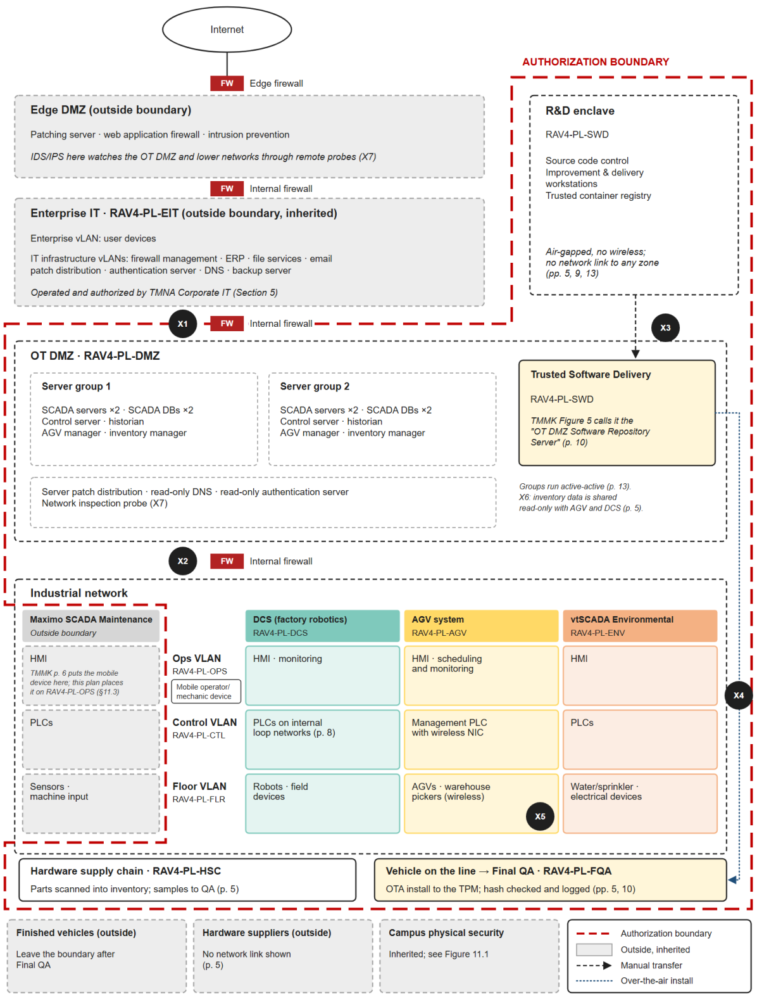

# System Security Plan: Toyota TMMK RAV4 Hybrid Production Line

**SIE 573: Engineering Trustworthy Secure Systems** · University of Arizona, College of Engineering · Fall 2026 · Team 5

A semester-long systems security engineering project. Team 5 acted as Toyota's Systems Security Engineers and took a new RAV4 Hybrid production line at Toyota Motor Manufacturing Kentucky (TMMK) through the NIST Risk Management Framework. The team produced a formal **System Security Plan (SSP)** with **305 tailored NIST SP 800-53 Rev. 5 controls** for a converged IT/OT manufacturing environment.

> **Disclaimer:** This is an academic case study. The scenario and architecture come from course materials and do not represent Toyota's actual operations, security posture, or business goals.

---

## The problem

TMMK added a production line for the RAV4 Hybrid with Toyota Safety Sense 2.0. The line is an industrial control system (PLCs, DCS, SCADA, AGVs, robotics) built on a Purdue-model network. It also delivers safety-critical driver-assist firmware into every vehicle it builds. The SSP had to answer four questions:

1. What are the cyber risks, and what impact could they have?
2. Which controls address the primary risks?
3. How do those controls make the line resilient to **outsider and insider** attacks?
4. If an attack is detected, how does the line get back online quickly?

## Key results

| Area | Outcome |
|---|---|
| **Categorization** (FIPS 199 / SP 800-60) | MODERATE overall: C = M, I = M, A = M, using the high-water mark across 4 information types and 11 subsystems. The plan notes that a real deployment would likely rate I and A as HIGH because of ISO 26262 safety impact and zero-downtime JIT production. |
| **Risk register** (SP 800-30) | 5 cyber-physical risks: four HIGH and one MODERATE. Each is mapped to its Purdue layer, threat actor, and a real-world precedent (Kojima Industries ransomware, Stuxnet, CVE-2023-29389). |
| **Authorization boundary** | 11 subsystems with unique IDs (`RAV4-PL-*`). 7 documented boundary crossings (X1–X7) and 2 assumed crossings (A1–A2), each with its vulnerability, controls, and disconnect authority. |
| **Control selection** (SP 800-53B + SP 800-82r3 OT overlay) | 305 controls and enhancements across 18 families: 287 from the Moderate baseline plus 18 OT/boundary additions (15 AC-4 information-flow enhancements, AC-17(9), AC-17(10), SI-17). 122 controls are flagged for the OT overlay. |
| **Core control strategy** | **AC-4** allowlisted flows at every Purdue transition · **SI-7** sign-at-source / verify-at-boot TPM chain of trust · **SR-6** read-only supplier data and EDI anomaly detection · **IR-4** unit-level quarantine on a Final QA hash mismatch (10–15 min containment target) |
| **Recovery** | A 7-step detect → contain → report → sustain → restore → verify → improve playbook built on WORM backups, active-active servers, and a redundant fiber ring |

Full per-family breakdown: [`docs/control-statistics.md`](docs/control-statistics.md)

## Architecture and authorization boundary

<p align="center"></p>

Enterprise IT → OT DMZ → Ops VLAN → Control VLAN → Floor VLAN. Every path into the industrial network passes through the OT DMZ. The R&D enclave is air-gapped, and its only exit is a manual, encrypted-media transfer (X3). More: [`docs/architecture.md`](docs/architecture.md)

## Risk register

| ID | Risk | Level | In boundary |
|---|---|:-:|:-:|
| R-01 | JIT supply-chain freeze: malware encrypts supplier EDI dependencies | HIGH | ✔ |
| R-02 | Air-gap tampering: Stuxnet-style payload on unverified transfer media | HIGH | ✔ |
| R-03 | Unauthenticated PLC logic manipulation via legacy protocols (Modbus, PROFINET) | HIGH | ✔ |
| R-04 | CAN bus injection through exterior harness (CVE-2023-29389) | HIGH | post-delivery |
| R-05 | Public cloud misconfiguration exposing vehicle data | MODERATE | enterprise |

Threat analysis, control traceability, and interconnection vulnerabilities: [`docs/risk-and-controls.md`](docs/risk-and-controls.md)

## Main finding

Reviewing the boundary crossings one by one showed a single repeating gap. **The architecture is good at deciding where traffic can go, and weak at checking whether what arrives is genuine.** Commands at X2 and software at X3 are trusted because of the path they took. Software at X4 is verified, but only *after* installation. Section 13 of the SSP is organized around that finding: boundary controls keep the paths narrow, and integrity controls (signed software, PLC logic baselines, OT-protocol-aware monitoring) check what crosses them.

## Repository layout

```
├── deliverables/                     Graded milestone submissions, in course order
│   ├── 01-team-charter/              Week 2: roles, Scrum working agreement, milestone plan
│   ├── 02-ics-analysis/              Week 3: ICS/OT architecture, threats, evolution of OT security
│   ├── 03-rmf-assessment/            Week 4: FIPS 199 categorization, boundary, risk register, RACI
│   ├── 04-controls-selection/        Week 5: 800-53 baseline selection workbook (L/M/H + OT overlay)
│   └── 05-system-security-plan/      Week 7: final SSP (46 pp.) + controls summary workbook
├── data/                             Machine-readable extracts
│   ├── ssp_controls_selection.csv    All 305 selected controls with implementation text
│   ├── risk_register.csv             R-01 … R-05
│   ├── subsystems.csv                11 subsystems: Purdue level, owner, C/I/A rating
│   └── boundary_crossings.csv        X1–X7, A1–A2: flows, vulnerabilities, controls, disconnect authority
├── docs/                             Readable summaries of the SSP
│   ├── architecture.md
│   ├── risk-and-controls.md
│   ├── incident-recovery.md
│   ├── control-statistics.md         (generated)
│   └── figures/
└── scripts/
    ├── export_controls.py            Workbook → CSV
    └── control_stats.py              CSV → per-family statistics table
```

### Reproduce the control statistics

```bash
pip install openpyxl
python scripts/export_controls.py          # xlsx -> data/ssp_controls_selection.csv
python scripts/control_stats.py --write    # -> docs/control-statistics.md
```

## Frameworks and standards applied

**NIST:** SP 800-37r2 (RMF) · SP 800-18r1 (SSP structure) · FIPS 199 / SP 800-60 (categorization) · SP 800-30r1 (risk assessment) · SP 800-53r5 / 800-53B (controls and baselines) · SP 800-82r3 (OT security overlay) · SP 800-160 Vol. 2 (cyber resiliency) · SP 800-161r1 (C-SCRM) · SP 800-47r1 (information exchange) · SP 800-137 (continuous monitoring)
**Industry and regulatory:** ISO 26262 · ISO/SAE 21434 · IEC 62443-3-2 · IATF 16949 · NHTSA Cybersecurity Best Practices (2022) · 49 U.S.C. §§ 30118–30120 · CIRCIA · Defend Trade Secrets Act

## Team 5

| Member | Charter role (Scrum) | RMF project role |
|---|---|---|
| **Mukwaya Lwere** ([@mlwere1977](https://github.com/mlwere1977)) | Developer: final proofread before submission | **Systems Security Engineer**: led the RMF lifecycle and SSP authorship, selected the baseline 800-53 controls |

## Milestones

| Milestone | Due | Artifact |
|---|---|---|
| Team Charter | Week 2 | [`deliverables/01-team-charter`](deliverables/01-team-charter) |
| Industrial Control Systems Analysis | Week 3 | [`deliverables/02-ics-analysis`](deliverables/02-ics-analysis) |
| Risk Management Framework Assessment | Week 4 | [`deliverables/03-rmf-assessment`](deliverables/03-rmf-assessment) |
| Controls Selection | Week 5 | [`deliverables/04-controls-selection`](deliverables/04-controls-selection) |
| Final System Security Plan | Week 7 | [`deliverables/05-system-security-plan`](deliverables/05-system-security-plan) |

---

<sub>Course-provided materials (the TMMK architectural description, the SSP template, and the project overview) belong to the University of Arizona and are not redistributed here. Team contact details have been removed from the published documents.</sub>
