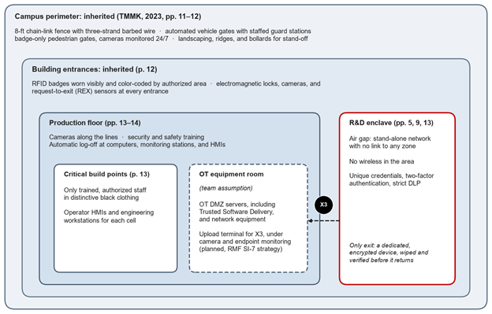
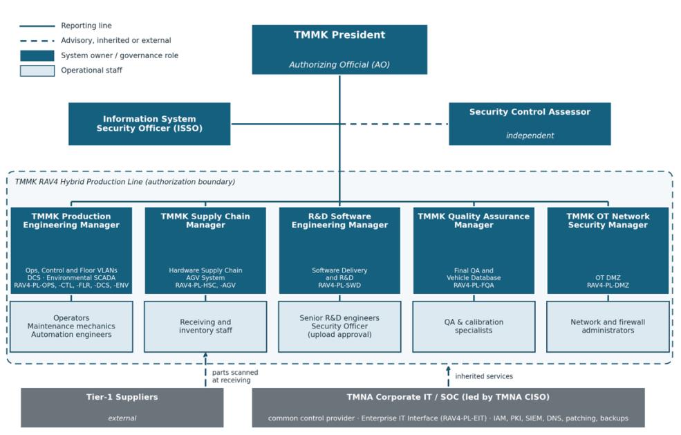

# System Architecture and Environment

Summarized from SSP Sections 2, 3, 7–9, and 11. Page references to "TMMK (2023)" point to the course-provided architectural description.

## Purdue-model segmentation

| Level | Zone | What lives there |
|---|---|---|
| 4 | **Enterprise IT** (outside boundary) | ERP, corporate IAM, SIEM/SOC, PKI, DNS, patching, backup, firewall management. Operated by TMNA Corporate IT as the common control provider. |
| 3.5 | **OT DMZ** `RAV4-PL-DMZ` | Two active-active server groups (SCADA servers and DBs, control and historian servers, AGV and inventory managers), the Trusted Software Delivery server, patch distribution, read-only DNS and authentication, and the network inspection probe |
| 2 | **Ops VLAN** `RAV4-PL-OPS` | HMIs, supervisor scheduling and monitoring workstations, mobile operator/mechanic device |
| 1 | **Control VLAN** `RAV4-PL-CTL` | PLCs/RTUs. PLCs in a cell talk over an isolated internal loop network. |
| 0 | **Floor VLAN** `RAV4-PL-FLR` | Robots, sensors, actuators, AGVs, environmental field devices |
| — | **R&D enclave** `RAV4-PL-SWD` | Air-gapped, no wireless, unique credentials plus 2FA and DLP. SafetySense 2.0 is developed here. |

Three in-scope industrial stacks repeat the Ops/Control/Floor pattern: **DCS** (factory robotics), the **AGV system** (JIT parts delivery over an unpublished, encrypted SSID), and **vtSCADA Environmental** (electrical, HVAC, water/sprinkler). A fourth stack, Maximo SCADA Maintenance, is an enterprise service outside the boundary.

## Subsystem categorization (FIPS 199)

| ID | Subsystem | C | I | A |
|---|---|:-:|:-:|:-:|
| RAV4-PL-DMZ | OT DMZ | M | M | M |
| RAV4-PL-OPS | Ops VLAN | L | M | M |
| RAV4-PL-CTL | Control VLAN | L | M | M |
| RAV4-PL-FLR | Floor VLAN | L | M | M |
| RAV4-PL-AGV | AGV system | L | M | M |
| RAV4-PL-ENV | Environmental SCADA | L | L | M |
| RAV4-PL-DCS | DCS | L | M | M |
| RAV4-PL-SWD | Software delivery and R&D | M | M | L |
| RAV4-PL-HSC | Hardware supply chain | L | M | M |
| RAV4-PL-FQA | Final QA and vehicle database | M | M | L |
| | **High-water mark** | **M** | **M** | **M** |

**Why a MODERATE system can have HIGH risks:** FIPS 199 categorization uses impact alone. The risk register (SP 800-30) weighs likelihood × impact. The team recorded that a real deployment would likely raise integrity and availability to HIGH, and kept MODERATE because the course required it.

## Information types (SP 800-60)

| Information type | Provisional C/I/A | Assigned C/I/A | Why adjusted |
|---|---|---|---|
| Manufacturing (D.22.1) | L/L/L | L/M/M | Tampered logic damages equipment or builds defects into vehicles; JIT cannot tolerate downtime |
| Supply chain (C.3.4.2 / C.3.4.3) | L/L/L | L/M/M | Missing inventory data immediately stalls JIT deliveries |
| Vehicle software/firmware (C.3.5.1) | L/M/L | M/M/L | Proprietary safety-critical code; leakage is a top architectural risk |
| Vehicle build and verification records (org-defined) | — | M/M/L | Links each VIN to its verified firmware hash; tampering would mask a bad install |

## Physical environment

Layers run from the outside in: an 8 ft fence with barbed wire → automated vehicle gates with guard checkpoints → badge-only pedestrian gates with 24/7 cameras → color-coded RFID badges, mag-locks, and REX sensors → distinctive clothing for staff at critical build points. All 18 PE controls are inherited from Plant Security and Facilities.

## Special security concerns (SP 800-18r1, p. 22)

- **Physical access is logical access** on a plant floor. HMIs that must stay live through an alarm cannot auto-lock, so the badge-controlled area around them is their main protection.
- **Mobile devices:** one operator/mechanic handheld (moved onto the in-scope Ops VLAN by this plan) plus the encrypted R&D transfer drives.
- **Wireless:** the AGV, environmental SCADA, and OTA vehicle installs. Jamming is the bigger risk here, because on a JIT line a jammed AGV network stops parts delivery as surely as ransomware does.
- **Networks:** Modbus and PROFINET carry no authentication. The redundant fiber ring keeps the line up, but it carries a malicious command as reliably as a legitimate one.

## Governance

- **Authorizing Official:** TMMK President, advised by the TMNA CISO and the ISSO
- **System owners:** Production Engineering, Supply Chain, R&D Software Engineering, Quality Assurance, and OT Network Security managers
- **Separation of duties (AC-5):** physical assembly and network operations are kept separate from software integrity functions (R&D, QA). R&D uploads require dual authorization from a Senior R&D Engineer and the Security Officer.
