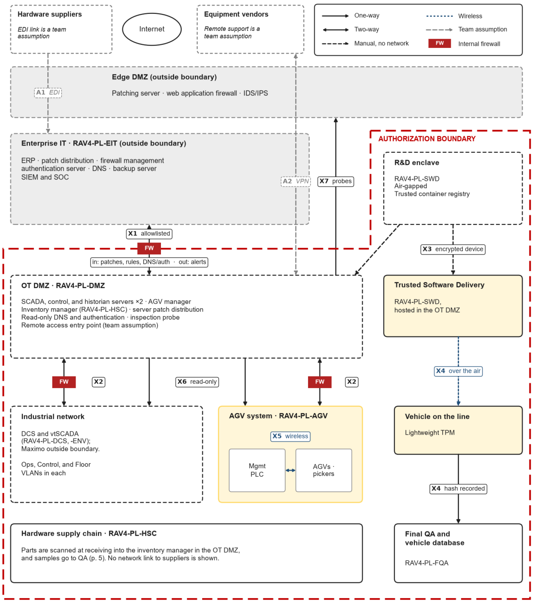

# Risks, Interconnections, and Control Traceability

Summarized from the RMF Assessment (Week 4) and SSP Sections 1, 3.3, 12, and 13. Machine-readable versions are in [`../data/`](../data).

## 1. Cyber-physical risk register (NIST SP 800-30r1)

| ID | Threat event / vector | Purdue layer → component | Actor | Consequence | Level |
|---|---|---|---|---|:-:|
| **R-01** | Malware encrypts shared network dependencies and freezes JIT supply chain | Enterprise IT → supplier EDI gateways | Outsider (cybercriminals) | Parts-sequencing data severed, plant-wide halt. The 2022 Kojima Industries attack stopped 14 plants and about 13,000 vehicles in one day. | HIGH |
| **R-02** | Stuxnet-style payload on unverified physical media crossing the air gap | R&D air gap → OT DMZ software server | Insider, or outsider via media | Unauthorized code executes on the delivery server with no signature or integrity check | HIGH |
| **R-03** | Unauthenticated PLC logic manipulation via legacy protocols | Control VLAN → Floor VLAN (PLCs, DCS) | Insider | Safety limits overridden; physical damage or latent structural defects | HIGH |
| **R-04** | CAN bus splice injection via exterior headlight harness (CVE-2023-29389) | Vehicle ECU (post-delivery, outside boundary) | Outsider | Forged "key validated" message unlocks and starts the vehicle in under 2 minutes | HIGH |
| **R-05** | Public cloud misconfiguration by an administrator | Enterprise IT → public cloud (outside boundary) | Insider | VINs, locations, and video for 2M+ vehicles exposed (Toyota 2012–2023 leak) | MOD |

R-01 to R-03 drive control tailoring. R-04 and R-05 are recorded so their owners (the vehicle cyber program and enterprise IT) can formally accept or mitigate them.

## 2. Four core control strategies

| Control | Strategy | Primary risks |
|---|---|---|
| **AC-4** Information Flow Enforcement | Allowlist ACLs at every Purdue transition. Firewalls, proxies, and tunneling are the only crossing mechanisms. Unused ports and services are disabled (least functionality). | R-01, R-02, R-03 |
| **SI-7** Software, Firmware & Information Integrity | **Sign at source, verify at boot.** SafetySense 2.0 is signed inside the R&D enclave, and each upload needs dual authorization (Senior R&D Engineer + Security Officer). Packages are recorded in a version-controlled registry with an immutable changelog. The vehicle's lightweight TPM verifies signature and hash before flashing, and the hypervisor verifies on each boot. The signature, not the transport medium, is the integrity control. | R-02, R-04 |
| **SR-6** Supplier Assessments & Reviews | Vendor data reaches AGV and DCS **read-only**, so a ransomware-encrypted supplier cannot write commands into the plant. Splunk SIEM monitors EDI for volume drops, malformed transactions, and timeouts, then fails over to a buffered sequencing dataset. Received parts are scanned and sampled to QA. | R-01 |
| **IR-4** Incident Handling | **Unit-level quarantine.** A Final QA hash mismatch diverts that one vehicle and its local network drop, not the whole Floor VLAN, and freezes OTA pushes from that build. TPM boot logs and registry changelog are collected for forensics. The unit is reflashed from a known-good signed image. Target: contained in 10–15 minutes. Findings feed the M-2 monitoring rules. | R-02, R-03 |

## 3. Interconnection vulnerabilities and who can pull the plug

The cheap cuts (a vendor session, a single Control VLAN segment) go to OT staff on the spot. Cuts that stop production go to the manager who answers for them.

| ID | Crossing | Vulnerability | Controls | Disconnect authority |
|---|---|---|---|---|
| X1 | Enterprise IT ↔ OT DMZ | Compromised enterprise host abuses an allowed flow or widens the allowlist; a malicious patch arrives by design | AC-4, AC-4(7), AC-4(9), SC-7(5), SI-2, CM-4 | OT Network Security Mgr; TMNA SOC |
| X2 | OT DMZ ↔ industrial VLANs | No protocol authentication: any Control VLAN host can write to a PLC | AC-4(2), AC-6(10), SI-4(2), IR-4 | On-site engineers, per segment |
| X3 | R&D → Trusted Software Delivery | Nothing checks the package at the handoff | SI-7, SI-3, AC-5, CM-5 | R&D Software Eng. Mgr; Security Officer may refuse |
| X4 | Delivery → vehicle TPM → Final QA | Tampering caught only after installation | SI-7(1), SI-7(7), IR-4, SC-8(1) | Automatic quarantine; QA Mgr escalation |
| X5 | AGV mgmt PLC ↔ AGVs (wireless) | Jamming or rogue AP halts deliveries | AC-18, AC-18(1), SC-5 | OT Network Security Mgr |
| X6 | Inventory → AGV/DCS (read-only) | Bad data still drives deliveries | AC-4(7), SI-10, CP-9 | OT Network Security Mgr |
| X7 | OT probes → Edge DMZ IDS/IPS | Compromised probe bridges zones; edge sensors don't parse ICS commands | SI-4, SI-4(2), AC-4(21) | OT Network Security Mgr |
| A1 | Suppliers → EIT → inventory *(assumed)* | Ransomware spreads inward or starves JIT | SC-7(4), AC-4(7), SR-6, CP-2 | TMNA SOC / OT NetSec Mgr |
| A2 | Vendors ↔ OT DMZ entry *(assumed)* | Stolen vendor creds give remote PLC programming access | AC-17(3), AC-17(9), AC-17(10), AC-20 | OT staff at entry point |

## 4. Control areas

| Area | Families | Scope in SSP |
|---|---|---|
| Network & Boundary Security | SC; AC-2 … AC-6(1) | 52 controls: allowlisted zone transitions, deny-by-default DMZ, authenticated proxies, PKI/mTLS where devices support it, segmentation as compensating control for legacy protocols |
| System Integrity & Flaw Management | SI; AC-6(2) … AC-18 | 38 controls: read/write privilege tiers for OT (only named engineers download PLC logic), alarm-instead-of-lockout on critical HMIs, single managed vendor entry point, OT-protocol monitoring, fail-safe states (SI-17) |
| Identity & Access Management | IA; AC-18(1) … AC-22 | 33 controls: mostly inherited enterprise IAM; tailored OT device authentication (IA-6, IA-7, IA-11) to limit who can program PLCs |
| Contingency, Recovery & Supply Chain | CM, CP, IR, SR | 72 controls: change control with test-then-deploy in maintenance windows, WORM backups, active-active servers, fiber ring, quarantine-first IR, supplier scanning and sampling |
| Inherited and assessment | AT, AU, MA, MP, PE, PL, PS, RA, SA, CA | 110 controls: 101 inherited from TMNA and facilities; 9 tailored CA controls govern assessment, POA&M, ATO, and continuous monitoring |

### Controls added beyond the Moderate baseline (18)

`AC-4(1)` `AC-4(2)` `AC-4(4)` `AC-4(7)` `AC-4(8)` `AC-4(9)` `AC-4(10)` `AC-4(11)` `AC-4(15)` `AC-4(17)` `AC-4(20)` `AC-4(21)` `AC-4(25)` `AC-4(26)` `AC-4(32)` `AC-17(9)` `AC-17(10)` `SI-17`

All but SI-17 harden the zone boundaries and remote access that the whole architecture depends on. SI-17 (fail-safe procedures) defines safe stop states for robots and AGVs if control is lost.

## 5. Residual risk: what the boundary controls do *not* solve

| Risk | Gap left by Network & Boundary controls | Where it is handled |
|---|---|---|
| R-01 | Cannot prevent a supplier-side outage | CP failover to buffered data; SR vendor risk monitoring |
| R-02 | Does not verify the package itself | SI-7 signatures, hashes, registry |
| R-03 | Cannot add authentication to Modbus/PROFINET | IA engineer authentication; SI-4(2) anomaly detection on writes |
| R-04 | A harness splice is a physical attack on a sold vehicle | Final QA hash checks; vehicle cyber program |
| R-05 | Workbook scopes these controls to OT devices | Enterprise CM and IAM |

Planned controls and unpatchable flaws are tracked in the POA&M (CA-5) until implemented.
